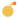
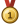
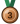
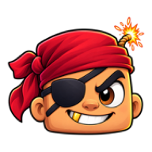

<p align="center">
  <a href="https://bombvoyage.online">
    
  </a>
</p>

<p align="center">
  <a href="https://bombvoyage.online"></a>
  
  
  <a href="LICENSE"></a>
</p>

<p align="center">
  <b>A browser game for up to sixteen players.</b> Open a link, type a name, and you are on the
  island: dropping bombs, cracking crates, chaining powder kegs and racing for gold. Nothing to
  install and no account to make.
  <br>
  Inspired by <b>Bomberman</b>, <b>Game of Bombs</b> and <b>Crazy Arcade</b>.
</p>

<br>

##  The rules, quickly

Ten minutes a round, across five islands. Drop a bomb, get clear, and be standing when the clock
runs out.

| | |
|---|---|
| Move | <kbd>W</kbd> <kbd>A</kbd> <kbd>S</kbd> <kbd>D</kbd> or the arrow keys |
| Drop a bomb | <kbd>Space</kbd> or <kbd>K</kbd>. It lands on the tile you face. The same key respawns you when you are down |
| Emote | Hold <kbd>Shift</kbd> and tap a direction |
| Chat | <kbd>Enter</kbd> |
| Scoreboard | <kbd>Tab</kbd>, which also shows the all-time board |
| Close a panel, or leave | <kbd>Esc</kbd> |

Bombs burn in a cross and stop at walls. A blast that reaches another bomb sets it off too, and
chains are where rounds are won. Your own fire kills you exactly as fast as anyone else's. Dying
costs you fifteen seconds on the death screen, which is long enough to watch the fight you just
left.

##  On the island

| | |
|---|---|
|  **Bombs and fire** | A cross-shaped blast, stopped by walls, passed on to any bomb it touches. |
|  **Powder kegs** | Rare barrels that erupt in a huge blast the moment they break. At least one every round. |
|  **Stamina** | Sprint for about ten seconds, then you limp. Stopping to catch your breath is a decision. |
|  **Perks** | Extra bombs, bigger fire, boots, a shield, stim for stamina, and rum, which makes you tough and very hard to steer. |
|  **Ice** | Melts into a puddle when hit. Half pace, and you slide when you let go. |
|  **Gold** | The rarest drop. Changes nothing in the round, counts for a great deal on the leaderboard. |
|  **Seagulls** | They cross the sky now and then. Catch one in a blast at the bottom of its dive and it drops gold. Watch its shadow. |
|  **Kill streaks** | Double, triple, ultra, rampage, and an **ACE** for wiping out the whole island in one run. |

##  Medals

A medal is a podium finish. They are awarded at the end of every round and kept for good.

| | | |
|---|---|---|
|  | **Gold** | First place |
|  | **Silver** | Second place |
|  | **Bronze** | Third place |

Gold coins are a separate thing: they are picked up off the floor during a round, and they are
counted on the board beside your medals.

##  Stats and scoring

Round score resets every round. Lifetime score is kept in one small file on the server and shown
on the all-time board, along with kills, deaths, medals and coins.

| Action | Score |
|---|---|
| Kill | +100 |
| Gold coin | +400 |
| Survive the round | +50 |
| Perk picked up | +5, or +15 once that perk is at its cap |
| Block broken | +2 |
| Suicide | &minus;25 |

##  Ranks and XP

Lifetime score is your XP, so everything that scores also levels you up. A decent hour of play is
worth roughly 12,000, level 1 arrives in about a minute, and Veteran takes around a hundred hours.

| Level | Rank | Lifetime score |
|---|---|---|
| 1 | Rookie | 200 |
| 5 | Rookie | 21,420 |
| 10 | Rookie | 160,324 |
| 11 | Been around the block | 211,447 |
| 16 | Pro | 627,708 |
| 20 | Veteran | 1,200,000 |

Levels keep going above Veteran. The rank stops there.

##  Run your own island

Bomb Voyage is one small Node.js server with no database. To try it on your own machine:

```bash
npm install
npm start            # then open http://localhost:8080 in two tabs
```

Settings live in an optional `config.ini` (copy `config.example.ini`), and any of them can be set
as an environment variable instead:

| Setting | Default | |
|---|---|---|
| `port` | `8080` | Where the game is served |
| `max_players` | `16` | Seats on the island |
| `min_bots` | `6` | Bots kept in the game while anyone is playing (`0` to switch off) |

Bots join as soon as somebody arrives, so a first player is never alone, and they leave again when
the island empties. For a public server, see the deployment guide in [docs/DEPLOY.md](docs/DEPLOY.md).

<details>
<summary><b>Host commands</b>, for whoever is running the room</summary>
<br>

The host is the longest-standing player in the room, shown with a crown on the scoreboard. When
they leave, the role passes on automatically.

| Command | |
|---|---|
| `/restart` | Start the round over |
| `/map 0-4` | Switch island |
| `/roundtime 0.1-60` | Round length in minutes, live |
| `/gamespeed 10-200` | Speed the whole game up or slow it down |
| `/bots N` | Set the number of bots (anyone can use this) |
| `/kick NAME` | Remove a player |

</details>

##  Under the hood

- Vanilla JavaScript in the browser and Node.js on the server. No framework, no build step, two
  runtime dependencies.
- WebTransport over QUIC where the network allows it, with WebSocket as an automatic fallback.
  Players never notice which one they got.
- A shared, deterministic simulation. Browser and server run the same rules, so your movement and
  every explosion are predicted locally and almost never corrected.
- Art and sound effects generated in code, with four produced music tracks.
- 295 automated tests, run with Node's built-in test runner on every push.

| Read more | |
|---|---|
| [Design](docs/DESIGN.md) | What the game is for, and what it deliberately is not |
| [Rules](docs/RULES.md) | Every rule and number in the game |
| [Netcode](docs/NETCODE.md) | How it stays responsive on a slow connection |
| [Art and audio](docs/ART-AUDIO.md) | The look, the sound, and how both are made |
| [Architecture](docs/ARCHITECTURE.md) and [Protocol](docs/PROTOCOL.md) | For developers |
| [Status](docs/STATUS.md) | What is built and what is next |

##  Credits and licence

Inspired by **Bomberman**, **Game of Bombs** and **Crazy Arcade**. No art from any of them is
used. Everything in the game is original.

Code is released under the [MIT licence](LICENSE). The display typeface is used under its own
licence, included alongside it in `public/assets/fonts/`.

<p align="center">
  <br>
  <sub>Made in 2026 by cobusvonwielligh.</sub>
</p>
