<p align="center">
  <a href="https://bombvoyage.online">
    
  </a>
</p>

<p align="center">
  <a href="https://bombvoyage.online"></a>
  
  
  <a href="LICENSE"></a>
</p>

<p align="center">
  <b>The office bomb game.</b> Open a link, type a name, and you are on the island with up to
  fifteen colleagues — dropping bombs, cracking crates, chaining powder kegs and racing for gold.
  <br>
  Inspired by <b>Bomberman</b>, <b>Game of Bombs</b> and <b>Crazy Arcade</b>.
</p>

<br>

<p align="center">
  
</p>

## ⚓ Why teams play it

<table>
  <tr>
    <td width="33%" valign="top">
      <h3>🏴‍☠️ Zero friction</h3>
      Nothing to install, no accounts, no sign-up. A link and a name, and you are playing in
      under ten seconds — on any modern desktop browser.
    </td>
    <td width="33%" valign="top">
      <h3>⚡ Feels instant</h3>
      Your own moves are predicted the moment you press a key, and every explosion is
      computed on your screen at the same instant as on the server. Nobody dies to lag.
    </td>
    <td width="33%" valign="top">
      <h3>🤖 Never an empty island</h3>
      Bots join the moment someone arrives, so the first two players on a Friday still have a
      fight. When everyone has gone home, the bots leave too.
    </td>
  </tr>
  <tr>
    <td width="33%" valign="top">
      <h3>🛡️ Friendly to IT</h3>
      One hostname, one port, plain HTTPS. No third-party domains and no plugins, so a
      locked-down office network only has to allow one thing.
    </td>
    <td width="33%" valign="top">
      <h3>🏆 Something to play for</h3>
      Levels, ranks, gold, silver and bronze medals and an all-time leaderboard that carries
      over from round to round and week to week.
    </td>
    <td width="33%" valign="top">
      <h3>🎨 Hand-made world</h3>
      Every pirate, crate, wave and gull is drawn in code, with a soundtrack and sound design
      that follow the action — the sea even moves to the music.
    </td>
  </tr>
</table>

## 🎮 How to play

<table>
  <tr><td><kbd>W</kbd> <kbd>A</kbd> <kbd>S</kbd> <kbd>D</kbd> or arrow keys</td><td>Move</td></tr>
  <tr><td><kbd>Space</kbd> or <kbd>K</kbd></td><td>Drop a bomb — it lands on the tile you face. When down, respawn</td></tr>
  <tr><td>Hold <kbd>Shift</kbd> + a direction</td><td>Emote over your head</td></tr>
  <tr><td><kbd>Enter</kbd></td><td>Chat</td></tr>
  <tr><td><kbd>Tab</kbd></td><td>Scoreboard and the all-time board</td></tr>
  <tr><td><kbd>Esc</kbd></td><td>Close a panel, or leave</td></tr>
</table>

Rounds last ten minutes across five islands. Bomb your rivals, survive the blasts, and finish
the round on top of the board.

## 🏝️ On the island

| | |
|---|---|
| 💣 **Bombs & fire** | Blasts run in a cross and stop at walls. Catch another bomb and it goes off too — chains are where rounds are won. |
| 🛢️ **Powder kegs** | Rare barrels that erupt in a huge blast the moment they break. At least one every round. |
| 🧊 **Ice** | Melts into a puddle when hit: half pace, and you slide when you let go. |
| 🏃 **Stamina** | Sprint for about ten seconds, then you limp. Stopping to catch your breath is a decision. |
| 🎁 **Perks** | Extra bombs, bigger fire, boots, a shield, stim for stamina — and rum, which makes you tough and very hard to steer. |
| 🪙 **Gold** | The rarest drop. Changes nothing in the round, counts for everything on the leaderboard. |
| 🕊️ **Seagulls** | They cross the sky now and then. Catch one in a blast at the bottom of its dive and it drops gold. Watch its shadow. |
| 🔥 **Kill streaks** | Double, triple, ultra, rampage — and an **ACE** for wiping out the whole island in one run. |
| 👀 **Spectate** | Watch without taking a seat, even when the island is full. |

## 🧭 Run your own island

Bomb Voyage is a single small Node.js server with no database. To try it on your own machine:

```bash
npm install
npm start            # then open http://localhost:8080 in two tabs
```

Settings live in an optional `config.ini` (copy `config.example.ini`), and any of them can be set
as an environment variable instead:

| Setting | Default | |
|---|---|---|
| `port` | `8080` | Where the game is served |
| `max_players` | `16` | Seats on the island |
| `min_bots` | `6` | Bots kept in the game while anyone is playing (`0` to switch off) |

For a public server, see the deployment guide in [docs/DEPLOY.md](docs/DEPLOY.md).

<details>
<summary><b>Host commands</b> — for whoever is running the room</summary>
<br>

The host is the longest-standing player in the room, shown with a crown on the scoreboard. When
they leave, the role passes on automatically.

| Command | |
|---|---|
| `/restart` | Start the round over |
| `/map 0-4` | Switch island |
| `/roundtime 0.1-60` | Round length in minutes, live |
| `/gamespeed 10-200` | Speed the whole game up or slow it down |
| `/bots N` | Set the number of bots (anyone can use this) |
| `/kick NAME` | Remove a player |

</details>

## 🛠️ Under the hood

- **Vanilla JavaScript** in the browser and **Node.js** on the server. No framework, no build
  step, two runtime dependencies.
- **WebTransport over QUIC** where the network allows it, with **WebSocket** as an automatic
  fallback — players never notice which one they got.
- **A shared, deterministic simulation.** Browser and server run the same game rules, so your
  movement and every explosion are predicted locally and almost never corrected.
- **Art and sound effects generated in code**, with four produced music tracks.
- **294 automated tests**, run with Node's built-in test runner on every push.

| Read more | |
|---|---|
| [Design](docs/DESIGN.md) | What the game is for, and what it deliberately is not |
| [Rules](docs/RULES.md) | Every rule and number in the game |
| [Netcode](docs/NETCODE.md) | How it stays responsive on a slow connection |
| [Art & audio](docs/ART-AUDIO.md) | The look, the sound, and how both are made |
| [Architecture](docs/ARCHITECTURE.md) · [Protocol](docs/PROTOCOL.md) | For developers |
| [Status](docs/STATUS.md) | What is built and what is next |

## 📜 Credits & licence

Inspired by **Bomberman**, **Game of Bombs** and **Crazy Arcade**. No art from any of them is
used — everything in the game is original.

Code is released under the [MIT licence](LICENSE). The display typeface is used under its own
licence, included alongside it in `public/assets/fonts/`.

<p align="center">
  <br>
  <sub>Made with too many powder kegs at <b>eezi</b>.</sub>
</p>
